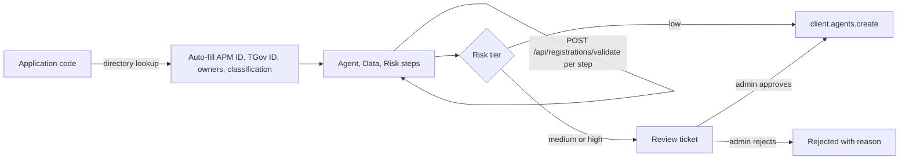

# Agent Registration (React)

A governed registration flow for TextQL agents, built with
[`@textql/sdk`](https://www.npmjs.com/package/@textql/sdk). Instead of handing
out agent-creation rights, users answer a fixed set of governance questions.
Every answer is validated against the systems that own application metadata,
and the agent is created only once the registration passes.

Low-risk registrations are created on submit with no human in the loop.
Anything riskier becomes a review ticket that an admin approves, and approving
it creates the agent. Set `REQUIRE_REVIEW=true` to send every registration
through review instead.

Built with Vite + React + Tailwind on the same design tokens, fonts, and
primitives as [`../react-demo`](../react-demo).

## Setup

```sh
git clone https://github.com/TextQLLabs/textql-ts-sdk.git
cd textql-ts-sdk/examples/agent-registration
npm install
cp .env.example .env   # set TEXTQL_API_KEY
npm run dev -- --open  # http://localhost:5176
```

The API key needs permission to list connectors and to list and create agents.
It never reaches the browser: the API routes run inside the Vite dev and
preview servers (`server/`).

Try application code `MKTG` with low-impact answers to see an agent created
on submit, or `CLMX` (PHI/PII) to see a review ticket. The sample directory in
`server/directory.ts` lists every seeded code, APM ID, and TGov ID.

## The flow



1. **Agent.** The application code is looked up in the directory, which fills
   in the APM ID, TGov ID, owners, line of business, and the application's
   data classification. The user names the agent and writes its instructions.
2. **Data.** Data classification, inputs, outputs, and the TextQL connectors
   the agent may query (listed with `client.connectors.getConnectors`).
3. **Risk.** Automatic decisions, impact, sensitive data handling, and where
   data goes.
4. **Review.** A summary, the computed risk tier, and what submitting will do.

Each Continue runs the same server-side validation the final submit runs, so
mistakes surface on the step that caused them rather than in a reviewer's inbox.

## The questions

| # | Question | Field | Checked by |
| --- | --- | --- | --- |
| 1 | Application Code | `applicationCode` | `lookupApplication` |
| 2 | Agent Name | `agentName` | Unique across registrations and `client.agents.list` |
| 3 | APM ID | `apmId` | `validateApmId`, must belong to the application |
| 4 | TGov ID | `tgovId` | `validateTgovId`, must be registered to the application |
| 5 | Makes Automatic Decisions | `automaticDecisions` | Schema |
| 6 | Agent Impact | `impact` | Schema |
| 7 | Data Classification | `dataClassification` | Schema, plus a cross-check against the inputs |
| 8 | Data Inputs | `dataInputs` | Schema, "Other" requires a description |
| 9 | Data Outputs | `dataOutputs` | Schema |
| 10 | Transforms or generates personal or sensitive data | `transformsSensitiveData` | Schema, "Not applicable" is refused for sensitive classifications |
| 11 | Sends data outside its hosting environment | `externalDataSharing` | Schema |

The agent also needs instructions and connectors to be created, so the form
asks for both.

## Wiring in your systems

| What | Where |
| --- | --- |
| Application, APM, and TGov APIs | Implement `GovernanceDirectory` in `server/directory.ts` and swap it for `sampleDirectory` in `server/routes.ts` |
| Questions, options, and cross-field rules | `registrationSchema` in `src/lib/registration.ts`, shared by the form and the server |
| Risk tiers | `assessRisk` in `src/lib/registration.ts`. The current rules are a placeholder until governance confirms the policy |
| Auto-create vs. review | `routeFor` in `server/routes.ts` and the `REQUIRE_REVIEW` env var |
| Registry of record | `server/store.ts` writes `data/registrations.json`. Point it at your own store |
| Who may approve | Nothing gates `/approve` and `/reject` here. Put them behind your admin auth before deploying |

## API

| Route | Purpose |
| --- | --- |
| `GET /api/applications/:code` | Directory lookup that powers auto-fill |
| `GET /api/connectors` | Connectors the agent can be scoped to |
| `POST /api/registrations/validate` | Field errors, risk tier, and route for a draft |
| `POST /api/registrations` | Validate, then create the agent or open a review ticket |
| `GET /api/registrations` | Every registration, newest first |
| `POST /api/registrations/:id/approve` | Create the agent for a pending or failed registration |
| `POST /api/registrations/:id/reject` | Reject with a required reason |

## Scripts

```sh
npm run dev      # dev server with hot reload (API routes included)
npm run check    # tsc --noEmit
npm run build    # production build
npm run preview  # serve the production build (API routes included)
```
